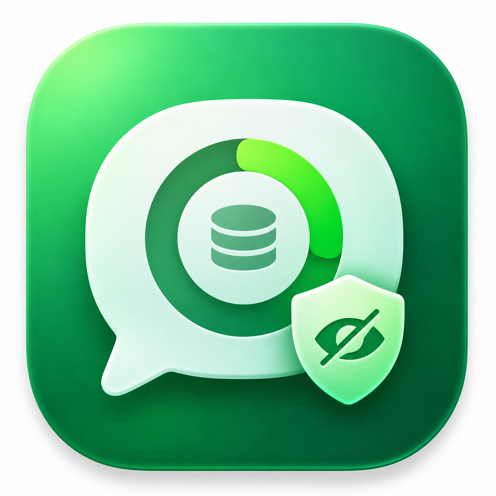

# WhatsCop

  

Read-only macOS WhatsApp media disk analyzer. Shows per-chat and per-file-type disk use and an age-based estimate. No deletion, message reading, database access, network access, or third-party dependencies.

Requirements: macOS with the native WhatsApp client and Python 3.9+.

## Usage

    ./whatscop
    ./whatscop --top 20 --older-than 180
    ./whatscop --show-ids
    ./whatscop --json

Optional local CLI installation:

    install -m 755 whatscop "$HOME/.local/bin/whatscop"

Run tests:

    python3 -m unittest discover -s tests -v

By default, chat IDs are redacted. The --show-ids option exposes identifiers and can reveal private details in logs. No chat messages or attachment contents are opened.

The native WhatsApp desktop app currently stores attachments in a Media directory within its shared Group Container. This location is an undocumented implementation detail and may change.

## Safety

- The scanner reads filesystem metadata only, never file contents or SQLite databases.
- It never modifies files, deletes media, or runs on a schedule.
- Symlinks are skipped and errors are reported.
- File modification age is not message age, and old media is not necessarily disposable.
- Allocated size is estimated using filesystem blocks. APFS clones and compression can cause discrepancies with actual space recoverable.
- Delete actual attachments through WhatsApp's own storage management tools, not by manipulating its live data directories.

This is a deliberately small first release, not a general-purpose macOS cleaner.

## Native macOS GUI (v0.2)

Build a standalone SwiftUI app with Xcode Command Line Tools (Apple Silicon, macOS 13+):

    ./macOS/test.sh
    ./macOS/build.sh
    open macOS/build/WhatsCop.app

The app uses a native Swift filesystem metadata scanner: **no Python runtime required**. It shows a disk summary, conversations (identifiers hidden by default), file types, and a selectable last-modified age threshold. Refresh is manual and scanning happens off the main thread. There is no background agent or deletion capability.

The CLI remains available as a separate tool, and can output JSON. No network access is required for either interface.

## Native macOS GUI (v0.3)

WhatsCop has a compact native macOS preferences-style interface (SwiftUI + AppKit toolbar tabs):
**Overview**, **Conversations**, **History**, and **About**. The AppIcon source is included in
the repository and is processed during the local build. It is an original icon, not an
official WhatsApp trademark.

### Build, install, test

    ./macOS/test.sh
    ./macOS/build.sh
    open macOS/build/WhatsCop.app

To install after quitting an older copy:

    ditto macOS/build/WhatsCop.app /Applications/WhatsCop.app
    open /Applications/WhatsCop.app

Requires macOS 13+ and Apple Silicon with Apple's Command Line Tools. This is an
ad-hoc signed development build, not a notarized distribution package.

### History

After each **complete** scan, WhatsCop writes only aggregate stats (UTC date,
timestamp, total allocated bytes, file count, and conversation-folder count) to:

    ~/Library/Application Support/WhatsCop/history.json

The file is local (mode 0600) and stores at most 180 daily snapshots. Rescans
on the same UTC day replace that day's entry. Incomplete scans are skipped.
No message contents, sender names, conversation identifiers, individual media
file names, or external uploads are included. The app does not monitor
WhatsApp continuously or run a background agent.

The analysis is **read-only with respect to WhatsApp's files**; only WhatsCop's
own aggregate history is written. An old file's modification time does not
make it safe to delete from WhatsApp.
